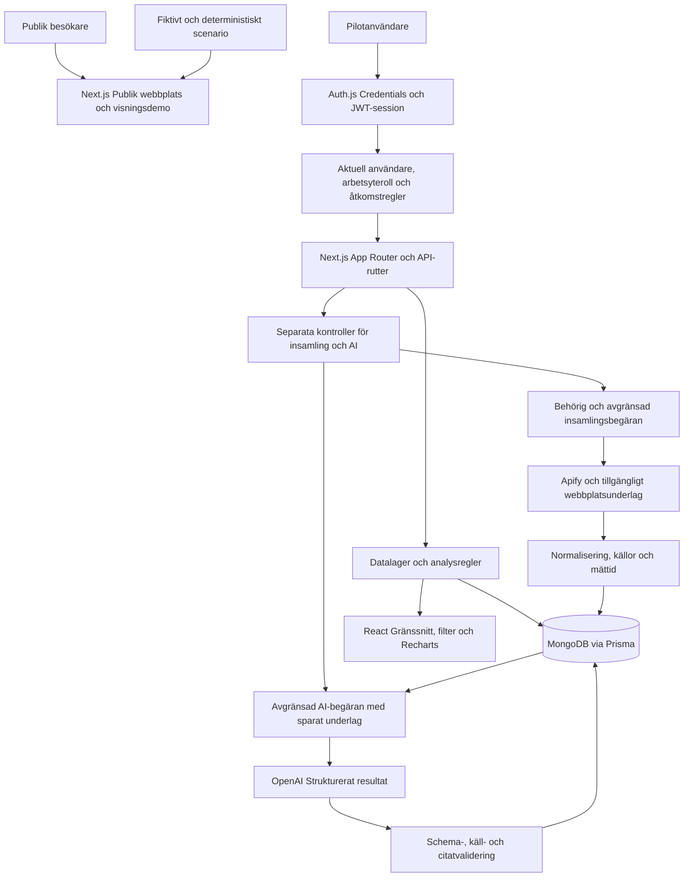

# SWOTFlows arkitektur

[Till presentationen](README.md)

Beskrivningen bygger på den lokalt granskade applikationskoden och den publika demon den 16 november 2026. Den skiljer mellan öppet demoinnehåll och privata pilotfunktioner.

## Applikationens delar

Diagrammet visar kodens ansvarsfördelning. Det betyder inte att alla flöden är aktiverade i den publika miljön. Visningsdemon använder sitt fiktiva scenario utan privata databasläsningar eller betalda leverantörsanrop.

## Frontend och backend

Next.js App Router kombinerar serverkomponenter för dataläsning med klientkomponenter för filter, formulär och diagram. API-rutter och serverns datalager ansvarar för privata operationer och skrivningar. TypeScript och Zod används för datatyper och validering.

## Identitet och arbetsytor

Användare kopplas till arbetsytor genom medlemskap och roller. Företagsprofil, konkurrenter och rapporter knyts till arbetsytan. Plattformens administrativa roll skiljs från en företagsägares roll i sin arbetsyta.

Inloggning använder Credentials, lösenordshashning med bcrypt och JWT-session. Privat åtkomst kontrolleras mot aktuell användare i databasen. Koden har inte ett färdigt generellt gränssnitt för att växla mellan flera bolag.

## Datamodell

| Modellområde | Ansvar |
|---|---|
| Identitet och medlemskap | Användare, roller och koppling till arbetsyta |
| Företagsprofil och konkurrenter | Eget företags uppgifter, självrapporterad kontext och jämförelseföretag |
| Sparade källor och historik | Inlägg, tillgängliga mätvärden, källänkar och tidpunkter |
| Körningar och resultat | Insamlingsstatus, reservering, gränser och sparad analys |
| Rapporter | Sparade ögonblicksbilder med arbetsytebaserad åtkomst |

Prismas datakälla är MongoDB. Andra databasrelaterade paket i beroendelistan innebär inte att den granskade produktmodellen använder PostgreSQL.

## Insamling och AI är separata operationer

Normal insamling är pausad i den granskade lokala koden. Begränsade engångsflöden finns separat med körningsposter och behörighetskontroller. AI har en egen pausflagga och använder sparat underlag i flera analysvägar. Aktiverad AI får därför inte automatiskt aktivera insamling.

Kostnads- och körningsgränser behöver gälla innan ett externt anrop startas. Osäkra eller avbrutna leverantörsanrop ska inte behandlas som kostnadsfria försök som kan upprepas utan kontroll.

## Publicering och miljöer

Koden innehåller Vercel-specifik styrning av produktion och preview samt avgränsad läsåtkomst i en testmiljö. Produktion, lokal kod och preview ska inte förutsättas ha identisk funktion eller åtkomst. Ingen ny publicering eller miljöändring har gjorts för denna portfölj.
