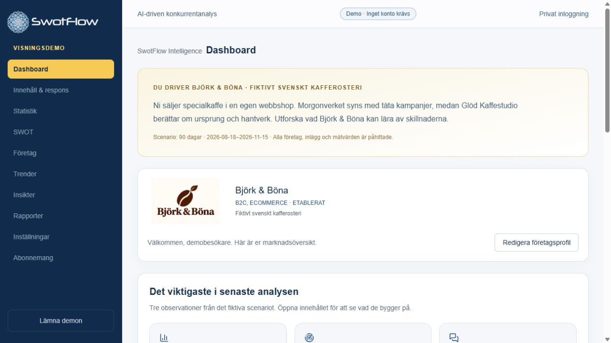
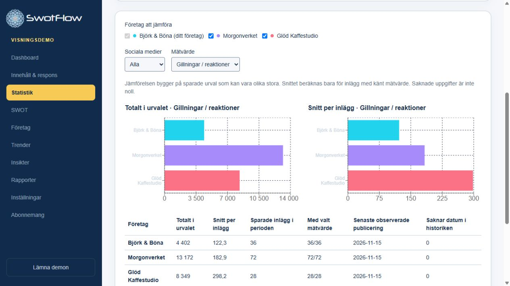
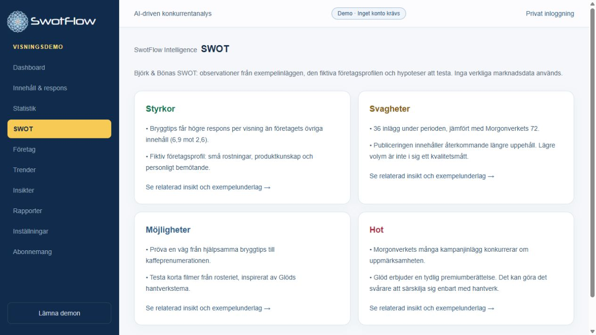

# SWOTFlow

**Sebastian Pavez · Fullstackutveckling · AI · Dataanalys · Produktutveckling**

SWOTFlow är ett B2B-verktyg som hjälper företag att analysera hur de och deras konkurrenter kommunicerar sina produkter till potentiella köpare, med fokus på sociala medier. Lösningen samlar företagsprofil, innehåll, mätvärden och observationer som underlag för jämförelser och SWOT-arbete.

[Besök webbplatsen](https://swotflow.com/) · [Utforska den öppna demon](https://swotflow.com/demo) · [Arkitektur](ARKITEKTUR.md) · [Teknik och designval](TEKNIK.md) · [Status och avgränsning](STATUS.md)

## Produktcase

Jag utvecklar Swotflow från produktidé och användarflöden till frontend, backend, datamodell och externa integrationer. Arbetet omfattar även analysregler, åtkomstkontroll, pilotbegränsningar och en publik visningsdemo som kan provas utan konto.

Den öppna demon följer ett fiktivt kafferosteri och två konkurrenter under en gemensam 90-dagarsperiod. Företag, inlägg, kommentarer och mätvärden är påhittade. Den visar produktens användarresa utan att exponera privata arbetsytor eller starta betalda analyser.

*Dashboarden för Björk & Böna sammanför företagsprofil och en ingång till analysens observationer. Bilden kommer från den publika demon.*

## Vad analysen kan och inte kan visa

SWOTFlow analyserar tillgänglig produktkommunikation: innehåll, budskap, teman och observerbar publikrespons. Det kan ge underlag för att jämföra hur företag presenterar sina produkter för potentiella köpare. Verktyget identifierar inte vilka mottagare som faktiskt vill köpa eller blir kunder och visar inte hur kommunikationen påverkar försäljningen. Potentiella köpare beskriver kommunikationens målgrupp, inte verifierad köpintention hos enskilda personer.

## Från innehåll till beslutsunderlag

- **Företagsöversikt:** profil, konkurrenter och sammanfattningar av tillgängligt underlag.
- **Innehåll och respons:** sparade inlägg och mätvärden samt tillgängligt kommentarunderlag.
- **Statistik:** filter för kanal, format och period samt jämförelse mellan eget företag och konkurrenter.
- **SWOT och insikter:** observationer, självrapporterad företagsinformation och hypoteser hålls isär och kopplas till underlaget.
- **Rapporter:** kod för sparade rapportögonblicksbilder och åtkomstregler finns i produktens backend; den publika demon använder exempeldata.

*Jämförelsen visar både totalvärden och snitt per inlägg. Urvalsstorlek och datatäckning syns separat. Mätvärden från olika kanaler bör inte tolkas som direkt jämförbar marknadsföringseffekt.*

*SWOT-demon visar strukturen och länkar till exempelunderlag. Hypoteserna är inte verifierade effekter hos verkliga företag.*

## Teknisk plattform

| Del | Teknik och ansvar |
|---|---|
| Applikation | Next.js 16 med App Router, React 19 och TypeScript |
| Gränssnitt | Tailwind CSS 4, Recharts, React Hook Form och Zod |
| Backend | Next.js API-rutter, serverkomponenter och separata datalager |
| Databas | MongoDB via Prisma |
| Identitet | Auth.js/NextAuth med Credentials, bcrypt och JWT-sessioner |
| Insamling | Apify-adaptrar och bearbetning av tillgängligt webbplatsunderlag |
| AI | OpenAI API för avgränsad bearbetning, strukturerade resultat och språkvarianter |
| Drift och versionshantering | Vercel-konfiguration för produktion och preview samt Git/GitHub |

Tekniken är verifierad i projektkoden. Att en integration finns i koden betyder inte att den är öppen för alla användare eller aktiverad i alla miljöer.

## Tekniska delar jag arbetar med

**Fullstack och informationsmodell.** Arbetsytor, medlemskap, företagsprofiler, konkurrenter, historiska mätvärden och analysresultat kopplas samman i en gemensam datamodell. Servern kontrollerar åtkomst till privata resurser.

**AI med spårbart underlag.** Analysfunktioner begränsar indata och validerar strukturerade svar. Käll-ID:n och ordagranna citat används för att knyta bedömningar till det innehåll som faktiskt har tillhandahållits. Statistik räknas i applikationskod i stället för att överlåtas åt språkmodellen.

**Kontrollerade externa anrop.** Insamling och AI har separata pauskontroller. Kod för avgränsade insamlingskörningar använder beständiga körningsposter, bekräftelse och gränser. Att öppna en vanlig sida ska inte i sig starta en betald insamling eller analys.

**Produktgränser.** Saknade mätvärden behandlas inte som noll. Publiceringsdatum skiljs från hämtningstid. Demodata hålls åtskilda från privata användardata, och Stripe-betalning är uttryckligen avstängd i den granskade koden.

## Status

Produkten är i pilotfas. Den öppna demon har granskats i webbläsare. Backend, datamodell, integrationskod och tester har lästs lokalt för denna presentation; inga privata data, externa insamlingsjobb eller AI-körningar har startats under granskningen.

Den granskade lokala koden har normal datainsamling pausad och en separat AI-kontroll som inte är pausad. Faktisk användning av privata AI-rutter kräver därutöver behörighet, rätt arbetsyta, tillåten operation och konfiguration. Detta är inte ett påstående om att alla lokala kodvägar är publicerade eller verifierade i produktion.

Se [statusöversikten](STATUS.md) för skillnaden mellan publik demo, privat implementation och verifiering som återstår.

## Om detta repo

Detta är ett separat publikt presentationsunderlag för SWOTFlow. Det hör inte till Microsoft 365-portföljen och innehåller inte den privata applikationskoden, kontolistor, databasexporter, hemligheter eller driftkonfiguration.

[Min GitHub-profil](https://github.com/SebastianChristobal) · [Publiceringsavgränsning](PUBLICERING.md) · [Rättigheter](RATTIGHETER.md)

Granskat 16 november 2026.
