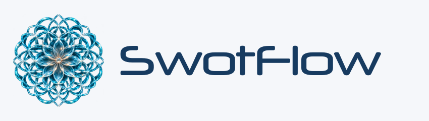

# Teknik och designval

[Till presentationen](README.md)

## Produktkommunikation som analysområde

SwotFlow är ett B2B-verktyg. Analysen avser hur företag kommunicerar produkter till potentiella köpare i tillgängligt innehåll, särskilt i sociala medier. Publikrespons är observerbara reaktioner och tillgängliga kommentarer, inte verifierad köpintention, kundidentifiering eller försäljningsutfall.

## Från rådata till jämförbart underlag

Apify-adaptrar och webbplatsbearbetning normaliserar tillgängligt underlag. Applikationen sparar bland annat källreferenser, mättid och uppgifter om vilka mätvärden som faktiskt finns. Ett saknat värde är inte ett uppmätt nollvärde.

Statistiken använder kanal-, format- och datumfilter. Sparade totalsiffror för ett inlägg skiljs från reaktioner som skulle ha uppstått under ett visst datumintervall. Jämförelser redovisar urvalsstorlek och begränsningar.

## Strukturerad AI-bearbetning

Den granskade koden använder OpenAI SDK och innehåller analysfunktioner med strukturerade svar och Zod-validering. Exempel är konkurrentanalys, innehållsfokus, bedömning av tillgängliga kommentarer och språkvarianter av sparade resultat.

I innehållsfokusfunktionen är källtext uttryckligen underlag, inte instruktioner till modellen. Indata begränsas och resultat kopplas till käll-ID:n. Citat valideras mot tillhandahållen text. Modellen ska inte påstå att den har sett bild eller video när endast text har skickats in.

Beräkningar och jämförande antal hanteras av applikationskod. AI-bedömningar ska inte göras om till påståenden om försäljning, kausalitet eller faktisk marknadsföringseffekt utan sådant underlag.

## Analysprofiler

Serverstyrda analysprofiler skiljer generell analys från ett observationsinriktat arbetssätt. Observationsläget ska beskriva underlaget utan att automatiskt skapa kommersiella rekommendationer eller tvinga in varje observation i en SWOT-kategori.

## Åtkomst och serverkontroller

Auth.js, aktuella databasuppgifter, arbetsytemedlemskap och operationens åtkomstregler kontrolleras på servern. Visningsdemon är separat från de privata produktvägarna. Abonnemangsregler och betalningsaktivering är också separata: kod för Stripe finns, men betalningar är avstängda.

## Språk och återanvändning av resultat

Gränssnittet har lokaliseringsresurser för svenska, engelska och latinamerikansk spanska. Sparade analysresultat och deras språkvarianter hanteras separat från ursprungliga källtexter. Att resurser finns i koden innebär inte att varje språk eller analysväg har verifierats i den publicerade demon.

Förberedda resultat kan läsas utan att varje sidvisning startar ett nytt AI-anrop. Översättning är en separat operation som kan innebära API-kostnad.

## Testunderlag

Projektet har Node-baserade tester för bland annat demo-isolering, fiktiva data, åtkomst, abonnemangsregler, statistik, källunderlag, språk och insamlingslogik. Typkontroll, ESLint och produktionsbygge ingår i det dokumenterade utvecklingsflödet.

Under projektutvecklingen har verkliga insamlings- och AI-anrop genomförts, privata inloggningar testats och resultat sparats i databasen. Den 12 november passerade 182 automatiska tester vid den senast dokumenterade fullständiga körningen. Den 17 november kontrollerades aggregerad körningsstatus och förekomsten av sparade resultat. Ingen ny insamling, AI-körning eller fullständig regression gjordes för denna dokumentationsuppdatering.

## Visuell identitet

Den befintliga logotypen kombinerar en vatteninspirerad symbol med ordmärket SwotFlow i **Neuropol Regular**. Typografin ger namnet en teknisk identitet, medan vattenformen knyter an till flödet av information genom produkten. Neuropol används i ordmärket; gränssnittets löptext har en separat typografi för läsbarhet.

Färgvalen utgår från solens gula, himlens blå och månens grå: gult används som accent, blått i navigation och text, och ljusa grå toner i bakgrunder och kort. Arbetet omfattar också responsiv hero, mobilnavigation och konsekvent utformning av demo och arbetsytor.

Bilden är en statisk export av appens befintliga symbol och ordmärke. Den lokala fontdokumentationen anger Neuropol Regular av Ray Larabie/Typodermic som CC0; fontfilen distribueras inte i presentationsrepot.
